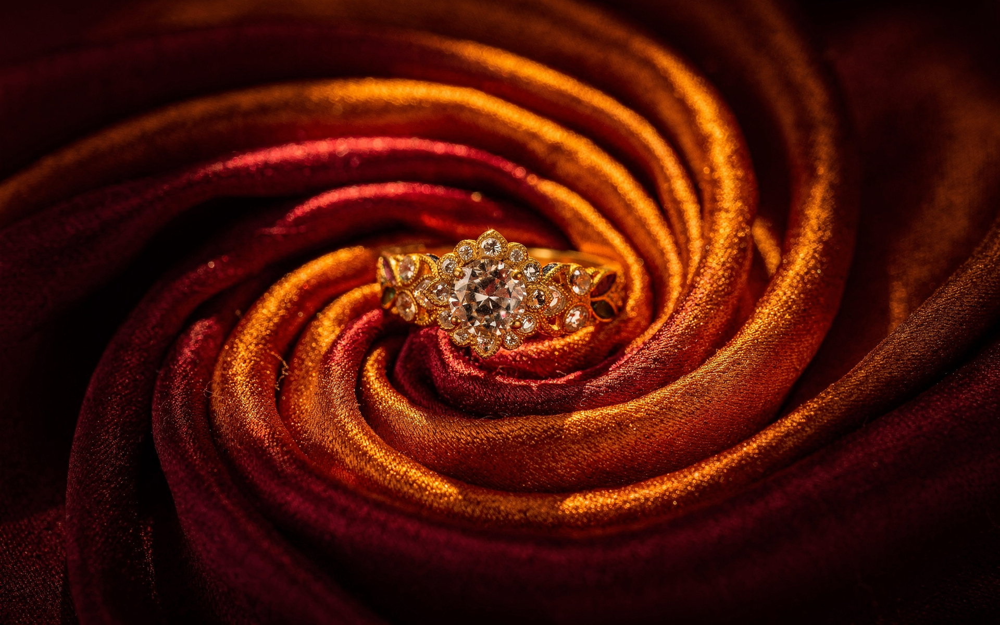

# AARANYA — Design System

Source of truth for building all new pages. Extracted from `index.html` (single homepage). Read this before writing any markup.

---

## 1. Brand Identity

- **Name:** AARANYA
- **Tagline (page title):** "AARANYA — Hand-set diamonds & 22K gold"
- **Category:** Fine jewellery maison / luxury e-commerce
- **Aesthetic notes:** Old-world couture; quiet, restrained luxury. Copy leans poetic and minimal ("LIGHT, RENDERED ETERNAL.", "A century of quiet obsession with light."). Every piece framed as handcrafted heirloom ("set every stone by hand", "the last unnecessary line always removed"). Marathi/Hindi-inspired naming (Genda Jhumka, Polki Reverie, Mogra Bangle). Palette is warm cream + deep forest green + ink black, evoking Jaipur atelier, silk, and heritage.
- **Origin line:** "Founded in Jaipur in 1908, our atelier still sets every stone by hand."
- **Voice:** third-person, hushed, editorial. Uses `&` instead of "and" in product descriptors.

---

## 2. Tailwind Config

Inline config from the `<script>` tag (full, verbatim):

```js
tailwind.config = {
  theme: {
    extend: {
      fontFamily: {
        serif: ['"Playfair Display"', 'serif'],
        sans: ['Inter', 'system-ui', 'sans-serif'],
      },
      colors: {
        cream: '#f5edd6',
        creamLight: '#faf5e6',
        creamDark: '#ede3c6',
        forest: '#0d5545',
        forestDark: '#0a4336',
        ink: '#1a1a1a',
        muted: '#6b6b6b',
      },
    },
  },
};
```

Fonts loaded via Google Fonts:
- **Playfair Display** — weights 400, 500, 600, 700 (roman + italic)
- **Inter** — weights 300, 400, 500, 600

Additional non-Tailwind CSS in a `<style>` block (reusable, copy into any page):

```css
html { scroll-behavior: smooth; }
body { font-family: 'Inter', sans-serif; background: #f5edd6; color: #1a1a1a; }
.font-serif-i { font-family: 'Playfair Display', serif; font-style: italic; }
.eyebrow { font-size: 11px; letter-spacing: 0.22em; text-transform: uppercase; color: #6b6b6b; font-weight: 500; }
.btn-pill {
  display: inline-flex; align-items: center; gap: 0.6rem;
  background: #0d5545; color: #f5edd6;
  padding: 0.85rem 1.6rem; border-radius: 999px;
  font-size: 13px; letter-spacing: 0.04em; font-weight: 500;
  transition: background 0.2s ease;
}
.btn-pill:hover { background: #0a4336; }
.heart {
  width: 28px; height: 28px; display: inline-flex; align-items: center; justify-content: center;
  background: rgba(255,255,255,0.9); border-radius: 999px;
  position: absolute; top: 12px; right: 12px;
  font-size: 13px; color: #1a1a1a;
  cursor: pointer;
}
.divider-scallop {
  height: 32px;
  background-image: radial-gradient(circle at 16px 0, #f5edd6 16px, transparent 17px);
  background-size: 32px 32px;
  background-repeat: repeat-x;
}
.card-hover { transition: transform 0.35s ease; }
.card-hover:hover { transform: translateY(-4px); }
```

Body element class: `class="bg-cream text-ink antialiased"`

---

## 3. Typography Scale

| Use | Classes (verbatim) | Notes |
|---|---|---|
| Hero H1 | `font-serif text-[56px] md:text-[72px] leading-[1.02] font-medium tracking-tight` | Playfair, medium, tight leading |
| Section H2 | `font-serif text-5xl md:text-6xl mt-3 font-medium tracking-tight` | Standard display heading; add `leading-[1.05]` for two-line |
| Section H2 (alt leading) | `font-serif text-5xl md:text-6xl mt-3 font-medium tracking-tight leading-[1.05]` | "Century" section |
| Stat number | `font-serif text-5xl md:text-6xl font-medium` | Overlaid on imagery |
| Card heading (featured) | `font-serif text-xl mt-4` | Maison cards |
| Card heading (product) | `font-serif text-lg` | Best-seller rows, horizontal justify |
| Newsletter title | `font-serif text-4xl md:text-5xl font-medium leading-[1.1]` | Two-line, with italic span |
| Logo wordmark | `font-serif text-2xl tracking-[0.35em] font-medium` | AARANYA, nav + footer; also `text-2xl` |
| Pull-quote glyph | `text-4xl font-serif text-forest leading-none` | `&ldquo;` |
| Italic accent | `.font-serif-i` (or `font-serif-i` class) | CSS class, Playfair italic — used inside H1/H2/titles |
| Eyebrow label | `.eyebrow` | 11px, 0.22em letterspacing, uppercase, muted, weight 500 |
| Sub-description | `text-sm text-muted max-w-md mx-auto mt-5 leading-relaxed` | Paragraph under H2 (optional `text-cream/85 max-w-sm` variant on dark) |
| Card sub-line | `text-xs text-muted mt-1 tracking-wide` | Material line under featured cards |
| Product meta line | `text-[11px] text-muted mt-0.5` | e.g. "22K Gold · Handwoven" |
| Price | `text-sm font-medium` | e.g. "₹1,85,000" |
| Body copy | `text-sm leading-relaxed text-ink/85` | Testimonial text |
| Attributed name | `text-sm font-medium` | Testimonial author |
| Footer column link | `text-xs text-muted mb-3` (heading) / `space-y-1.5 text-sm` (links) | See footer |
| Footer micro | `text-xs text-muted` | Copyright + column headings |
| Nav links | `text-sm` inside `flex items-center gap-8 text-sm` | |

Weight usage: Headings use `font-medium` (500) — never bold. Body uses Inter (default 400; 500 for emphasis like prices/names). Italic Playfair (`font-serif-i`) is the signature accent for one word or phrase per heading.

---

## 4. Color Palette

| Token | Hex | Semantic role |
|---|---|---|
| `cream` | `#f5edd6` | Primary page background; light text on forest buttons; hero text |
| `creamLight` | `#faf5e6` | Card image tile backgrounds |
| `creamDark` | `#ede3c6` | Defined but not used on page (reserve for hovers/dividers) |
| `forest` | `#0d5545` | Primary CTA / button background; pull-quote glyph; active dot |
| `forestDark` | `#0a4336` | Button hover state |
| `ink` | `#1a1a1a` | Headings/body text default; icon color |
| `muted` | `#6b6b6b` | Eyebrows, captions, meta lines, footer text |
| white | rgba(255,255,255,0.9) | Heart button tile background |

Opacity variants in use:
- `bg-cream/95` — sticky nav, newsletter input
- `bg-cream/85` — newsletter input variation (via `bg-cream/95`)
- `text-ink/85` — testimonial quotes
- `text-cream/85` — hero + newsletter body text
- `text-cream` — hero/overlay text
- `bg-ink/20` — inactive testimonial dot
- `bg-black/5` — borders (nav bottom, footer, footer bottom)
- `bg-black/50`, `bg-black/20`, `bg-black/45` — image gradient overlays
- `text-muted` / `placeholder:text-muted` — placeholders

---

## 5. Spacing & Layout Conventions

- **Container:** `max-w-[1400px] mx-auto` — every section. Variants: `px-6` (nav), `px-8` (most sections), `px-10 md:px-16` (overlay content on image blocks).
- **Body text gutter margin** uses `px-8` consistently.
- **Section vertical padding:** `py-16 md:py-24` (all standard sections), `py-24 md:py-32` (stats band only).
- **Section header stack:** `.eyebrow` label, then `h2` with `mt-3`, optional paragraph `mt-5`. Internal margin helper `mb-14` on the header block (Century section).
- **Grid gutters:** `gap-6` (cards), `gap-8` (nav, stats, testimonials), `gap-12` (footer columns), `gap-2` (instagram tiles), `gap-5` (nav icons).
- **Card image aspect ratios:** `aspect-[3/4]` (standard product/maison), `aspect-[4/5]` (side cards), `aspect-[16/10]` (big feature card), `aspect-[2/3]` (instagram tiles).
- **Rounded corners:** `rounded-sm` on image tiles and overlays; `rounded-full` on pills/hearts/dots.
- **Nav icon set:** inline SVGs `width="18" height="18" viewBox="0 0 24 24" fill="none" stroke="currentColor" stroke-width="1.5"` (person, heart, shopping bag).
- **Arrow icon in CTAs:** `width="14" height="14" viewBox="0 0 24 24" fill="none" stroke="currentColor" stroke-width="2"` with `<line x1="5" y1="12" x2="19" y2="12"/><polyline points="12 5 19 12 12 19"/>`.
- **Testimonial dots:** `w-2 h-2 rounded-full bg-forest` (active) / `w-2 h-2 rounded-full bg-ink/20`.

---

## 6. Reusable Component Patterns

### Header / Nav
```html
<header class="w-full bg-cream/95 backdrop-blur sticky top-0 z-50 border-b border-black/5">
  <div class="max-w-[1400px] mx-auto px-6 py-4 flex items-center justify-between">
    <nav class="flex items-center gap-8 text-sm">
      <a href="#shop" class="hover:opacity-70">Shop</a>
      <a href="#collections" class="hover:opacity-70">Collections</a>
      <a href="#about" class="hover:opacity-70">About</a>
      <a href="#contact" class="hover:opacity-70">Contact</a>
    </nav>
    <a href="#" class="font-serif text-2xl tracking-[0.35em] font-medium">AARANYA</a>
    <div class="flex items-center gap-5 text-ink">
      <!-- account / wishlist / bag buttons, each class="hover:opacity-70", SVGs 18x18 stroke-width="1.5" -->
    </div>
  </div>
</header>
```
Interaction: links/buttons use `hover:opacity-70`. Bag button is `relative` (badge-ready).

### Hero
```html
<section class="relative w-full">
  <div class="relative w-full h-[86vh] min-h-[560px] max-h-[820px] overflow-hidden">
    
    <div class="absolute inset-0 bg-gradient-to-r from-black/50 via-black/20 to-transparent"></div>
    <div class="relative z-10 max-w-[1400px] mx-auto px-8 h-full flex items-center">
      <div class="max-w-xl text-cream">
        <h1 class="font-serif text-[56px] md:text-[72px] leading-[1.02] font-medium tracking-tight">
          LIGHT, <span class="font-serif-i">RENDERED</span><br />ETERNAL.
        </h1>
        <p class="mt-6 text-sm md:text-base text-cream/85 max-w-sm leading-relaxed">...</p>
        <a href="#collections" class="btn-pill mt-8">Discover the Collection <svg .../></a>
      </div>
    </div>
  </div>
</section>
```

### Section Heading (standard)
```html
<section class="py-16 md:py-24">
  <div class="max-w-[1400px] mx-auto px-8 text-center">
    <div class="eyebrow">Featured</div>
    <h2 class="font-serif text-5xl md:text-6xl mt-3 font-medium tracking-tight">
      Four maisons <span class="font-serif-i">of light.</span>
    </h2>
    <!-- optional: <p class="text-sm text-muted max-w-md mx-auto mt-5 leading-relaxed">...</p> -->
    <!-- body grid with mt-14 -->
  </div>
</section>
```

### Product Card (best seller — with price row)
```html
<div class="card-hover">
  <div class="relative bg-creamLight rounded-sm overflow-hidden aspect-[3/4]">
    
    <span class="heart">♡</span>
  </div>
  <div class="flex items-baseline justify-between mt-3">
    <div>
      <h3 class="font-serif text-lg">Mogra Bangle</h3>
      <p class="text-[11px] text-muted mt-0.5">22K Gold · Uncut Polki</p>
    </div>
    <div class="text-sm font-medium">₹1,28,000</div>
  </div>
</div>
```

### Featured Card (maison — no price, `text-left`)
```html
<div class="card-hover">
  <div class="relative bg-creamLight rounded-sm overflow-hidden aspect-[3/4]">
    
    <span class="heart">♡</span>
  </div>
  <h3 class="font-serif text-xl mt-4">Emerald Elegance</h3>
  <p class="text-xs text-muted mt-1 tracking-wide">Emerald &amp; Diamond</p>
</div>
```

### CTA Button (`btn-pill` custom class)
```html
<a href="#shop" class="btn-pill">View All Collections <svg width="14" height="14" viewBox="0 0 24 24" fill="none" stroke="currentColor" stroke-width="2"><line x1="5" y1="12" x2="19" y2="12"/><polyline points="12 5 19 12 12 19"/></svg></a>
```
Centered variant wrapper: `<div class="mt-12">`; with `text-center` parent.

### Instagram Grid Tile
```html
<div class="aspect-[2/3] overflow-hidden"></div>
```
Grid parent: `mt-12 grid grid-cols-3 md:grid-cols-6 gap-2`.

### Newsletter Signup (overlay on image)
```html
<div class="relative rounded-sm overflow-hidden">
  
  <div class="absolute inset-0 bg-gradient-to-t from-black/45 via-black/20 to-transparent"></div>
  <div class="absolute inset-0 flex items-end">
    <div class="w-full max-w-lg px-10 md:px-16 pb-14 text-cream">
      <h3 class="font-serif text-4xl md:text-5xl font-medium leading-[1.1]">Letters from the <span class="font-serif-i">atelier.</span></h3>
      <p class="text-sm text-cream/85 mt-3 max-w-sm">...</p>
      <form class="mt-6 flex flex-wrap items-center gap-3 max-w-md">
        <input type="email" required placeholder="Your email address" class="flex-1 min-w-[220px] px-5 py-3 rounded-full text-sm text-ink bg-cream/95 placeholder:text-muted focus:outline-none" />
        <button type="submit" class="btn-pill">Subscribe</button>
      </form>
    </div>
  </div>
</div>
```

### Footer
```html
<footer id="contact" class="pt-16 pb-10 border-t border-black/5 mt-8">
  <div class="max-w-[1400px] mx-auto px-8">
    <div class="grid grid-cols-2 md:grid-cols-4 gap-12">
      <div>
        <div class="font-serif text-2xl tracking-[0.35em] font-medium">AARANYA</div>
        <p class="text-xs text-muted mt-4 leading-relaxed max-w-xs">...</p>
        <div class="mt-6 space-y-1.5 text-xs"><!-- social links, class="block hover:opacity-70" --></div>
      </div>
      <!-- 3 link columns: heading <p class="text-xs text-muted mb-3">, list <ul class="space-y-1.5 text-sm"> with <a class="hover:opacity-70"> -->
    </div>
    <div class="mt-16 pt-6 border-t border-black/5 flex flex-wrap items-center justify-between gap-4">
      <p class="text-xs text-muted">© MMXXVI AARANYA Maison Jaipur — India</p>
      <div class="text-xs text-muted">Hand-set in Jaipur, delivered worldwide</div>
    </div>
  </div>
</footer>
```

### Testimonials
Quote mark: `<div class="text-4xl font-serif text-forest leading-none">&ldquo;</div>`, quote `text-sm leading-relaxed text-ink/85`, author name `text-sm font-medium`, location `text-[11px] text-muted mt-0.5`. Grid: `mt-14 grid grid-cols-1 md:grid-cols-4 gap-8 text-left`.

---

## 7. Imagery & Animation Notes

- **Photography:** editorial jewellery still-life on textured Indian surfaces — red silk swirls, marigolds, hibiscus, jasmine, lotus, golden sand dunes. All images full-bleed, `object-cover`. Alt text is always descriptive.
- **Image treatment:** warm, slightly desaturated, natural light; product aligned to one side of frame for overlay space.
- **Overlays:** left-to-right `bg-gradient-to-r from-black/50 via-black/20 to-transparent` on hero; bottom-up `bg-gradient-to-t from-black/45 via-black/20 to-transparent` on newsletter.
- **Hover:** `card-hover` lifts cards 4px (`translateY(-4px)`, 0.35s ease). Links fade with `hover:opacity-70` (no color change). Buttons darken `#0d5545 → #0a4336` (0.2s ease).
- **Nav:** sticky with `backdrop-blur` + `bg-cream/95`.
- **Scrolling:** `scroll-behavior: smooth` on `html`; anchor links `#shop`, `#collections`, `#about`, `#contact`.
- **Motion budget:** minimal. Everything is a gentle fade/lift — no parallax, no carousels, no autoplay on the homepage.
- **Heart button:** white circular 28px badge, top-right `top: 12px; right: 12px`, contains `♡`.

---

## 8. "How to Build a New Page" Checklist

1. **Copy the exact `<head>`** from index.html: CDN Tailwind (`apps.tailwindcss.com` or `cdn.tailwindcss.com`), Playfair Display + Inter Google Fonts link, and the full `tailwind.config` + `<style>` block (eyebrow, btn-pill, heart, divider-scallop, card-hover, font-serif-i, body rules). Extend `tailwind.config` only if you add a brand color.
2. **Use `class="bg-cream text-ink antialiased"` on `<body>`.** If sticky nav is needed, mirror the header verbatim; update nav links to new page anchors.
3. **Reuse, don't reinvent:** pull every component from Section 6 (header, hero, section heading, product card, featured card, btn-pill CTA, newsletter, footer). Change only text/image sources, not class strings, unless a layout genuinely differs.
4. **Wrap every section body in** `max-w-[1400px] mx-auto px-8`.
5. **Section rhythm:** `py-16 md:py-24` for sections, `py-24 md:py-32` for a hero-stat band. Use `mt-14` or `mt-12` to gap the header from its grid.
6. **Section heading formula:** `.eyebrow` label → `h2` (`font-serif text-5xl md:text-6xl mt-3 font-medium tracking-tight`) with one short phrase wrapped in `<span class="font-serif-i">…</span>` → optional centered paragraph.
7. **Cards:** always wrap in `card-hover`; image tile container `relative bg-creamLight rounded-sm overflow-hidden aspect-[X/Y]` + `<span class="heart">♡</span>` + `w-full h-full object-cover` image. Maintain aspect-ratio consistency per grid.
8. **Type rules:** headings/wordmark Playfair at weight 500 only (`font-medium`); body Inter 400; emphasis (prices, names) Inter 500. Max one `font-serif-i` accent phrase per heading. Never use bold (700) for headings.
9. **Colors:** use only the 7 tokens from Section 4 plus approved opacity variants. Forest = CTAs/accents, cream = backgrounds, ink = text, muted = captions. Don't introduce new hexes.
10. **Imagery:** descriptive `alt` text; editorial still-life style; place CTA text over genuine empty space using the approved gradient overlays.
11. **CTAs:** use `btn-pill` class verbatim (it carries font/color/padding); append the 14px arrow SVG for links. For email inputs reuse the newsletter input recipe.
12. **Footer:** mirror the footer verbatim; keep brand block + 3 link columns + legal row. Update anchor targets for the page.
13. **Verify:** page must feel consistent with the homepage — same fonts, tokens, spacing, hover language (`hover:opacity-70`, `card-hover`) — and not introduce new rounded radiuses beyond `rounded-sm` / `rounded-full`, or new motion.